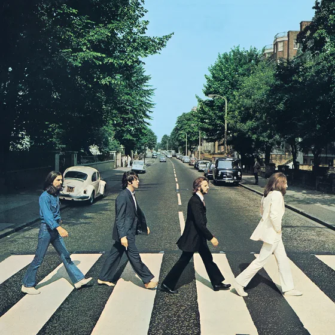
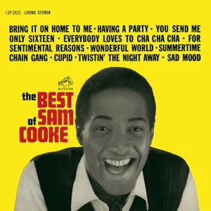
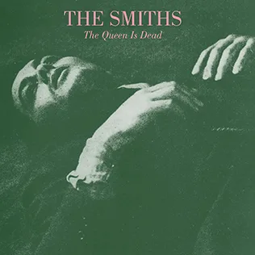
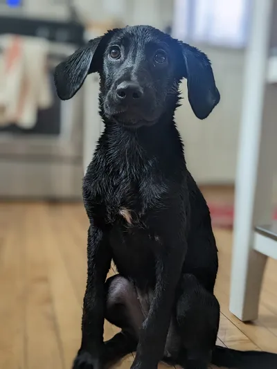
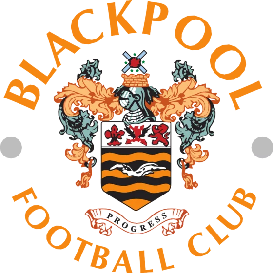

# Alright! I'm Charles. I like working with people, building things, and helping businesses.

Location: Albany Park, Chicago, IL
Button: [Get in touch](#contact)

## Areas of expertise

After working freelance for a total of ~11 years my projects have been all over the shop. It keeps me on my toes. I sit somewhere between marketing and software, and most of my best work happens where the two meet. Here are the major threads:

### Marketing & Analytics

1. **Paid search & paid media** I started out as a PPC Executive, and I've never really left. Google Ads is home turf, and I've run Display, Affiliates, Retargeting and paid social on Meta alongside it.
   I've managed Google Ads accounts (amongst other things) consistently since ~2011. You can't beat the buzz of watching those numbers improve!
2. **Tracking & analytics** If the numbers are wrong, everything built on them is wrong too. I've set up a lot of conversion tracking (server side, or otherwise) with Google Analytics and Google Tag Manager, and I'm happy digging into why two reports disagree.
   Then there's the reporting itself: Looker Studio dashboards, Google Sheets with Apps Script doing the heavy lifting, and plenty of analysis besides.
3. **E-commerce & CRO** As an E-commerce Manager I got to see the other side of it all: margins, stock, staffing, ROI, scaling, the lot. I ran A/B tests (CRO) and learnt that a good campaign is only as good as the page and the product behind it.
4. **CRM & marketing automation** HubSpot, email and the plumbing between them. Getting leads from the ad, to the CRM, to someone's inbox without anything falling through the cracks.

Logos: Google Ads, Microsoft Ads (Bing), Amazon Ads, Meta, Google Merchant Center, Shopify, Squarespace, HubSpot, Google Analytics, Google Tag Manager, Search Console, Looker Studio, Google Sheets, Apps Script, AdEvolver, Shabba

### Software

1. **Website & Web App Development** This is where it all began, and it continues to this day. My degree is in "Interactive Digital Media" which was essentially a Web & Graphic design degree. On the backend I've worked with Laravel & Wordpress (PHP), Express (Node.js), FastAPI, Django & Flask (Python). For the shop window, I've written a lot of vanilla JavaScript/TypeScript, but also worked extensively with libraries like Vue & React.
   I'm _ok_ with CSS, but if you're looking for a slick, well designed UI/UX I am _not_ your man.
2. **Cloud & DevOps** I have a decent amount of Google Cloud experience (APIs, BigQuery) however, I've used AWS far more. Within AWS, I rely on a lot of the classics: EC2, S3, Lambda, ECS/Fargate, SQS, SNS, WAF, CloudFormation, and more acronyms besides!
   I've also worked with AWS's Step Functions as a workflow orchestration tool, as well as Prefect and Airflow.
   Whilst I don't claim to be a DevOps expert, CI/CD via GitHub actions, Pre-commit checks, linting, automated testing, strong observability, etc. are a large part of every project I work on.
3. **Data and automation** I got a job in PPC and immediately had access to all of this data! It needed processing, turning into reports, analysis, etc. and I reached immediately for Python. I've worked with Python (including Pandas, NumPy, Polars, etc.) every since - going on ten years.
   As well as workflow orchestration, I've worked with Data Lakes and Data Warehouses, AWS Athena & RedShift, BigQuery, as well as DuckDB/Parquet workflows.

Logos: PHP, Laravel, WordPress, JavaScript, TypeScript, Node.js, Express, Vue, React, Python, FastAPI, Django, Flask, pandas, NumPy, Polars, MySQL, PostgreSQL, DuckDB, Parquet, BigQuery, Google Cloud, AWS, Docker, GitHub Actions, Prefect, Airflow

## Experience

**GoDaddy · Software engineer**
_This falls in with my freelancer work, but it's worth its own section after three years of almost full time_
It's my job to build tools and automations for their Paid Media team. It has spanned Google Ads Scripts, AI Systems & MCPs, Web Apps and Python tools - anything to make the ads more profitable, and the team more productive.
I've probably learnt more here than anywhere else, including university!

**Freelance · Marketing & Software**
I've been working freelance since 2017, offering my services to businesses large and small.
See [available for hire](#freelance) for what I get up to!

**Limitless Digital · E-commerce Manager**
I started as a PPC Executive, then had a stint as a Commercial Analyst before settling as E-commerce Manager. I really enjoyed this job. It helped me understand the other side of it all - margins, stock, staffing, ROI, scaling, the lot.
It gave me experience with Google Ads, Affiliates, Display Ads, Tracking, Retargeting, A/B Testing (CRO), not to mention all of the reporting and analysis involved.
I made sure I had access to _everything_ and automated as much as possible. Probably a little too much, in fact!

## What people say

Pull quote: Charles went above and beyond as always! — Upwork client

These are genuine reviews, copied word for word, typos and all. They're a mixture of UpWork clients and people who've found me through my website.

> Charles did a great job **adhering to our timeline** and getting the job done **quicker than expected**. He is great with Wordpress and google analytics. I trust him with all our web developer and optimizing needs!
— Upwork client

> Charles was fantastic to work with! He **went above and beyond what I ask of him**. He **anticipated my needs** and was able to solve problems before they arose.
> He not only fixed our problems, but he **gave us the tools to fix them ourselves** in the future.
> I feel like he cared how about me and my business getting our problem solved. Way more than what I asked for!
> Thank you Charles! I look forward to working with you again in the future!
— Upwork client

> Charles' scripts are of **excellent quality and save me a lot of time**. The work is delivered beautifully. Charles is also very friendly. He offers an excellent service. I highly recommend Charles.
— Ruben B., Google Ads Specialist

> Charles helped me **convert a single account script to an MCC script in no time**! He also ensured that I could successfully implement the script in my accounts and was around to **help me troubleshoot** any issues that arose. I recommend his service!
— Upwork client

> **Corrected all of our website issues** and updated all of our information. Thank you Charles for **always being there** when we need technical help!
— Upwork client

> Charles **went above and beyond as always**! He helped restore our website and set us up with tracking for our website. He also finished the job **in less than 24 hour** which was fantastic so we did not lose any future customers while our website was down.
> I really appreciate all the hard work and time you put into our website.
> Charles is an **honest web developer** and I highly suggest working with him!
— Upwork client

> Amazing script... it's a **game changer** for our franchisee clients who are getting a ton of irrelevant search impressions/clicks with phrase match.
— Paid Media Manager

> Thank you, Charles, for helping with all of our website needs! He goes above and beyond and always gives **great suggestions** on what will be the **most efficient option** to solve all of our web issues.
> Our website transitions **went smoothly** thanks to Charles!
— Upwork client

> **Quick and effective!** Thank you Charles for helping us set us everything for our new business! I really appreciate all the help! He **made the whole process simple** and set our business up for success
> I highly suggest all of Charles services!
— Upwork client

> Charles created a beautiful webpage for our business. It is **modern and very professional**; he really went above and beyond! He took extra time to add features and links to make the page **stand out from our competitors**
> I highly recommend Charles services!
— Upwork client

> Awesome work with the **Auto Negative Keywords Script**!
— Alex M., Search Director

> Charles always goes **above and beyond the call of duty**! Thank you for all your assistance with our homepage edits and making sure our website is **mobile friendly**!
— Upwork client

> Charles handled the project **quickly and efficiently**. I feel very lucky that I found him ono upwork! He was able to make a change on our website **in just a couple minutes**.
> I look forward to working with him on bigger projects in the future!
— Upwork client

> Charles was **easy to work with**! He **communicated with me through the entire project** updating me on progress or additional steps.
> I highly recommend working with Charles! I look forward to working with him in the near future for all our web designer needs!
— Upwork client

> Your scripts have **saved me so much time** - huge thanks!
— PPC Professional

> Charles was **extremely helpful** and got the job done in a timely manner!
— Upwork client

> **Excellent developer.** Looking forward to work with Charles in the future.
— Upwork client

> Your Negative Keyword script is **awesome**!
— Liam, small business owner

## Upwork

I've been working successfully on Upwork since 2017.
[See my Upwork profile](https://www.upwork.com/freelancers/~01e842945d01cd7e0e?mp_source=share)

Stats:
- **$100K+** earned on Upwork
- **42** jobs completed
- **1,822** hours worked
- **100%** Job Success

## Available to hire

I'm available for freelance projects, from web development and web apps to the systems behind them, especially where a business has an operational problem that needs a dependable system built around it.

What can I help with?

### Let's start with some things I _don't_ do:

Pretty Pictures & Design: Anything heavily graphic design or art oriented, whether it's a beautiful website or graphics for print. This includes UX/UI design, logos, branding, anything like that. This stuff is a real craft, and it's worth hiring a professional.

Small business Brochure-type websites: there are people who have this down to a fine art. Use them, or maybe try AI or Squarespace.

### As for things I _do_ do

I'm better at backends, services, tooling, connecting things together.
It might be:

#### Marketing

- Google Ads account management
- Landing page optimization (CRO)
- Conversion tracking (server side, or otherwise)
- Reporting & dashboards
- Data processing & pipelines
- AI workflows

#### Software

- A widget or calcualator for your website
- A custom web app
- Help with your existing service, website or system
- Custom automation, such as automatically making Google Ads changes

If you've got a problem, we can work together to come up with a solution.
Then, I can build it in a reliable, maintainable manner.

## Get in touch

Got a project, a problem or just a question?

Form:
- What should I call you? | placeholder: Freddie Mercury
- Where do you work? (optional) | placeholder: Queen
- How can I get in touch? | placeholder: freddie@queen.com
- Phone number (optional)
- What's your message? | placeholder: Hi, I wondered if you could help with our website?
- Button: Send

Sent title: Thank you!
Sent text: I'll do my best to get in touch within the next 24 hours (business hours).

## Hobbies and interests

It's tempting to just talk about music here.
If I had to take five artists to a desert island I'd probably take The Smiths, The Beatles, Sam Cooke, The Kinks...then probably something operatic or classical - it would be a nice change.

I often attempt songs from these artists on my guitar to the dismay of my neighbours, dog and wife.

I'm also learning Spanish at a snail's pace. Yo se un pocito palabras (no idea if that's right), but I can't understand anything people say back to me, unfortunately.

I'm also into baking and growing herbs, though the twain seldom meet.
The herb thing is new. I currently have some Basil and Scallions peeking their heads above the soil and it's very exciting.

Plus just, ya know, watching Telly! Maybe it's boring, but a Tuesday eve with my wife, a glass of red (Garnacha) and an episode of Gogglebox is a real treat.

But enough about me!

